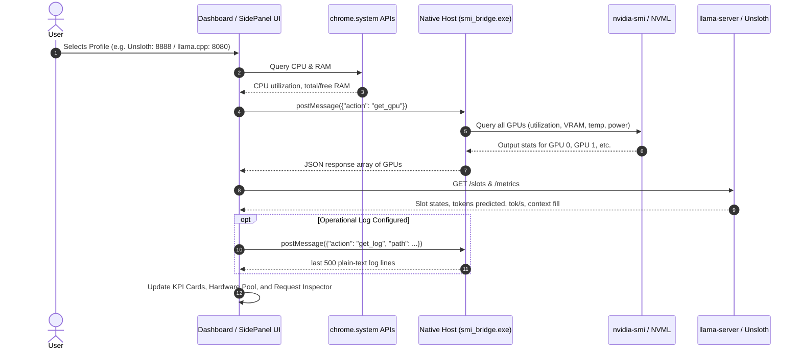

# Architecture Specification: Universal llama.cpp Monitor

## 1. System Overview
The **Universal llama.cpp Monitor** is a browser-integrated telemetry and inference monitoring system designed for local LLM inference engines (such as `llama.cpp`'s `llama-server`, Unsloth, Ollama, vLLM, and compatible servers).

It offers two viewing modes:
1. **Full-Browser Tab Dashboard (`dashboard.html`)**: Rich 2-column workspace with real-time multi-GPU VRAM telemetry, 8-fact request inspector, dynamic search/filter, and Gainsty design system (light/dark themes).
2. **Chrome Side Panel (`sidepanel/monitor.html`)**: Compact sidebar interface docked next to active web work.

---

## 2. Core Architecture Components

```
┌────────────────────────────────────────────────────────────────────────┐
│                          Google Chrome (MV3)                           │
│                                                                        │
│  ┌───────────────────────┐              ┌───────────────────────────┐  │
│  │ Background Service    │              │ Full Tab & Side Panel UIs │  │
│  │ Worker                │              │ (dashboard.html / monitor)│  │
│  │ - Action button click │              │ - Profile Switcher        │  │
│  │ - Tab replacement     │              │ - Dual GPU & VRAM Pool    │  │
│  │ - Side panel docking  │              │ - Slots & Context Gauge   │  │
│  └───────────┬───────────┘              │ - 8-Fact Request Inspector│  │
│              │                          └─────────────┬─────────────┘  │
│              │                                        │                │
│              │ chrome.runtime.connectNative           │ fetch()        │
│ └────────────┼────────────────────────────────────────┼────────────────┘
               │ (Standard I/O 32-bit JSON framing)     │
               ▼                                        │
┌─────────────────────────────┐                         │
│ Native Messaging Host       │                         │
│ (smi_bridge.exe, Go)        │                         │
│ - Strict Whitelist Dispatch │                         │
│ - Multi-GPU nvidia-smi / NVML│                        │
└──────────────┬──────────────┘                         │
               │                                        │
               ▼                                        ▼
┌─────────────────────────────┐         ┌────────────────────────────────┐
│ Host Hardware               │         │ Local Inference Server         │
│ - NVIDIA Driver / NVML      │         │ - http://localhost:8080        │
│ - Multi-GPU VRAM / Temp / W │         │ - http://localhost:8888        │
│ - CPU & System RAM metrics  │         │ - GET /slots, /metrics, /v1/models │
└─────────────────────────────┘         │ - Log Audit (plain-text slot print_timing) │
                                        └────────────────────────────────┘
```

### Component Roles:
1. **Full Tab Workspace (`dashboard.html` / `dashboard.js`)**:
   - Primary user view: renders top summary KPI cards, hardware telemetry, and an interactive 2-column request inspector.
   - Live multi-GPU telemetry cards with progress bars and temperature/power badges.
   - Real-time search, filter, and tabbed inspection (Prompt/Input, Output, Raw JSON).
2. **Side Panel Frontend (`sidepanel/`)**:
   - Lightweight companion rendered inside Chrome's Side Panel (`chrome.sidePanel`).
   - Quick glance at active slots, VRAM usage, and connection status.
3. **Background Service Worker (`background/service_worker.js`)**:
   - Manages extension lifecycle.
   - Opens the full dashboard or side panel depending on user interaction mode.
4. **Native Messaging Host (`host/main.go`, shipped as `host/smi_bridge.exe`)**:
   - Out-of-sandbox bridge launched and supervised by Chrome.
   - Implements Chrome's binary 32-bit uint32 message framing protocol.
   - Queries `nvidia-smi` across all installed GPUs and returns structured JSON.
   - Strictly enforces action whitelisting to eliminate command injection.

---

## 3. Data Flow & Sequence Diagram



---

## 4. Multi-Port Profile Specification

Profiles are stored in `chrome.storage.local` under the `profiles` key.

```typescript
interface Profile {
  id: string;              // Unique identifier (e.g., "unsloth", "llama-8080")
  name: string;            // User-friendly display name
  baseUrl: string;         // e.g., "http://127.0.0.1:8080"
  logFile: string;         // Optional file:/// path to logfile
  pollIntervalMs: number;  // Default: 1000ms
  enabledMetrics: boolean; // Query Prometheus /metrics
}
```

Pre-configured defaults:
- **Unsloth (Auto-Detect)**: `http://127.0.0.1:8888` (with automatic scanning across ports 8000–9050)
- **Default Llama Server**: `http://127.0.0.1:8080`
- **Alternative Server**: `http://127.0.0.1:9050`
- **Local Port 5001**: `http://127.0.0.1:5001`
